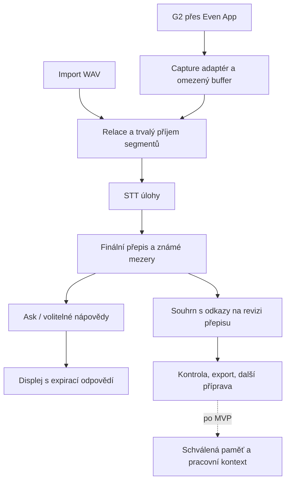

# Product spec — Even G2: rozhovory, paměť a pracovní kontext

Verze: 0.2 · Datum: 27. 10. 2026 · Stav: MVP implementováno, ověření na hardwaru otevřené

Výchozí implementace: `beast-g2` 0.5.0, commit `49484c2`.

Tento dokument obsahuje kritické review původního návrhu a jeho opravenou podobu. Požadavky popisují cílové chování; část MVP je implementovaná a její skutečný stav uvádí sekce 0. Číselné limity a metriky jsou navržené výchozí hodnoty pro pilot; nejsou výsledkem měření ani schváleným závazkem. Prováděcí plán etap a fází včetně rozdělení práce mezi agenty je v [ROADMAP.md](ROADMAP.md).

Pro další produktové iterace je toto konsolidovaný návrh navazující na [IRIS-COMPARISON.md](beast-g2/docs/IRIS-COMPARISON.md) a [BACKLOG.md](beast-g2/docs/BACKLOG.md). Rozdíly a změny priorit jsou výslovně uvedeny níže. Současné chování nadále popisují kód a provozní dokumentace. Specifikace sama nepovoluje zpracování firemních dat ani nasazení integrací.

## 0. Stav implementace k 27. 10. 2026

MVP z etap I1–I3 je implementované a lokálně ověřené. Následující tabulka rozlišuje druh důkazu; „hotovo“ znamená implementováno a pokryté testem, nikoli ověřené na skutečném hardwaru.

| Oblast | Stav | Důkaz | Co chybí |
| --- | --- | --- | --- |
| Serverové relace, segmenty, finální přepis, revize, mezery, export, smazání (I1) | Hotovo | 121 testů, 90s WAV jako tři segmenty, obnova jobu po restartu, smazání audia po přepisu | Ověření proti živému Beast STT |
| Souhrny a preparation snapshoty (I2) | Hotovo | 144 testů, migrace v2, HTTP tok create → end → summary → preparation, stale při nové mezeře | Kvalita souhrnů na živém modelu, lidské hodnocení |
| Klientské UI relací a G2 capture (I3) | Hotovo, ověřeno v simulátoru | 198 testů, lint, Prettier, build; prohlížeč proti demo gateway; EvenHub simulátor: tap z brýlí spustí poslech a tečou PCM eventy | Skutečný mikrofon G2, zamčený telefon, výpadky BLE, výdrž baterie |
| Živá pomoc (Ask, hinty, Captions) | Původní prototyp, beze změny | Testy controlleru a continuous režimu | Kvalita a četnost hintů, Captions režim |
| Paměť, hledání, pracovní kontext | Neimplementováno | – | Etapy I4–I6 v [ROADMAP.md](ROADMAP.md) |

Důkazy jsou z lokálního běhu na Node 20.18 (`better-sqlite3` je v tomto checkoutu kompilovaný pro Node 20) a z prohlížeče proti loopback demo gateway. Simulátor `@evenrealities/evenhub-simulator` ověřil doručení tap gesta z brýlí do aplikace; neověřuje kvalitu mikrofonu ani chování při zamčeném telefonu. Nasazení, HTTPS a reálné Beast inferenční volání zůstávají otevřené.

## 1. Produktové rozhodnutí

Stavíme osobního asistenta pro jeden konkrétní tok:

**Připravit se na rozhovor → zachytit jeho obsah → zkontrolovat souhrn a závazky → využít správný kontext při příštím rozhovoru.**

G2 poskytuje titulky a krátkou pomoc během rozhovoru. Telefon poskytuje ovládání a kontrolu výsledků. Vlastní backend uchovává vybrané relace a později poskytuje paměť dalším asistentům. Zachycení a zpracování relace musí fungovat také přes import testovacího audia, aby vývoj nebyl závislý na dostupnosti brýlí.

Primární uživatel první verze je technicky zdatný jednotlivec s G2, který chce navazovat na předchozí rozhovory a ovládat umístění svých dat. První pilot poběží na osobních nebo výslovně povolených nesenzitivních relacích. Pracovní briefingy jsou samostatné rozšíření po ověření základního přínosu.

Hlavní hypotéza: uživatel připraví další rozhovor a zpracuje předchozí s menší námahou, přičemž dohledá původ důležitých tvrzení. Kvalitu změříme včetně času oprav a kontroly.

## 2. Kritické review původního návrhu

| ID | Slabina | Dopad | Oprava v této specifikaci |
| --- | --- | --- | --- |
| CR-01 | První návrh spojil G2 copilot, second brain, pracovní orchestrátor a další hardware. | Vývoj rozsáhlé infrastruktury před ověřením užitku. | MVP končí uloženou relací, kontrolovatelným souhrnem a ruční přípravou další relace. Obecná paměť a konektory následují samostatně. |
| CR-02 | Historie odpovědí byla považována za možný základ záznamu schůzky. | Chybí promluvy bez hintu i promluvy, u kterých selhal chat. | Přepis ukládat nezávisle na chatu a rozhodnutí zobrazit nápovědu. |
| CR-03 | Chyběl rozbor přetížení současné pipeline. | Čtení nápověd může zpomalit STT a způsobit ztrátu audia. | Oddělit capture/STT/uložení od fronty nápověd; mít omezené fronty, potvrzení a evidenci mezer. |
| CR-04 | Dlouhé mluvení a pozastavení nebyly součástí návrhu. | Aktuální 30s limit a vyprázdnění front při pause nejsou vhodné pro schůzky. | Dlouhou řeč průběžně dělit; Pause zachová přijatá data, End dokončí zpracování, Delete data odstraní. |
| CR-05 | „Resume“ směšovalo obnovení obsahu, doručení dat a znovuzapnutí mikrofonu. | Falešná očekávání při reloadu, zamčení či výpadku BLE. | Samostatné stavy capture, synchronizace a zpracování. Obnovení poslechu vždy explicitní. |
| CR-06 | „Self-hosted“ znělo jako úplná kontrola nad celou datovou cestou. | Vlastní backend neřeší retenci inference provideru ani závislost na Even App. | Uvést příjemce STT/chat/úložiště; žádný automatický přechod na jiného poskytovatele. |
| CR-07 | Dlouhodobá paměť neměla životní cyklus oprav a mazání. | Staré nebo chybné tvrzení se může dál vracet jako fakt. | Původ a revize, datum, nahrazení poznatku a invalidace odvozených výstupů. |
| CR-08 | Citace mohly působit jako záruka pravdivosti. | Existující citace nemusí tvrzení podporovat; přepis může být chybný. | Kontrolovat existenci reference i věcnou oporu, rozlišovat přepis, interpretaci a potvrzení uživatelem. |
| CR-09 | Předčasná volba PostgreSQL a obecného agentního rozhraní. | Provozní a implementační náklady bez ověřené potřeby. | Jednouzlový backend; navržený start SQLite. MCP a migrace databáze mají vlastní podmínky. |
| CR-10 | Režimy byly navrženy před ověřením četnosti užitečných zásahů. | Více voleb a rušivých hintů. | V MVP ukládající Meeting a explicitní Ask. Automatické nápovědy opt-in; Captions jako malá následná iterace. |
| CR-11 | Pracovní paměť mohla vytvořit druhý tracker. | Rozpor mezi zaznamenaným slibem a skutečným stavem úkolu. | Oddělit závazek z rozhovoru od odkazovaného úkolu; aktuální stav číst z autoritativního systému. |
| CR-12 | Hardwarový test mohl blokovat i užitečný vývoj bez G2. | Čekání na zařízení brzdí ověření souhrnů a paměti. | Souběžné pracovní směry: relace nad audiem a ověření G2; žádný příslib bezobslužného provozu bez hardware testu. |
| CR-13 | Chyběl měřitelný důvod pokračovat nebo rozsah zmenšit. | Další funkce mohou zvýšit námahu místo jejího snížení. | Pilot se srovnáním ruční práce, sledováním chyb a předem danými podmínkami pokračování. |

### Důkazy v aktuálním kódu

- [continuous.ts](beast-g2/src/continuous.ts): `drain()` čeká při plné frontě odpovědí před zpracováním dalšího audia; STT a chat běží v jednom sériovém toku. `enqueue()` při dvou čekajících segmentech zahodí nejstarší. Audio starší než 30 sekund je přeskočeno.
- [continuous.ts](beast-g2/src/continuous.ts): `show:false` uchová promluvu jen v krátkém kontextu a přeskočí `archive.add()`. Selhání chatu také zabrání archivaci již získaného přepisu. `pause()` maže frontu a resetuje VAD.
- [conversation.ts](beast-g2/src/conversation.ts): historie má limit 20 odpovědí. Modelový kontext v controlleru má šest zpráv. Ani jedna struktura není úplným přepisem relace.
- [vad.ts](beast-g2/src/vad.ts): řeč bez dostatečné pauzy při dosažení 30 sekund přejde do overflow, nashromážděné frames se odstraní. Chování je explicitní omezení prototypu, ne segmentace dlouhé schůzky.
- [main.ts](beast-g2/src/main.ts): `visibilitychange` a `pagehide` vyvolávají pauzu. Zamčený telefon není ověřený provozní režim.
- [even.ts](beast-g2/src/even.ts) a [deadline.ts](beast-g2/src/deadline.ts): timeout klienta nepotvrzuje fyzické zastavení mikrofonu. Čekání na bridge a startup stránku má další otevřené limity.

V předchozí kontrole tohoto commitu prošlo 97 testů, typecheck, lint a kontrola formátování. Tato evidence se vztahuje k prototypu; neověřuje navrženou persistenci, úplnost schůzky ani skutečné zařízení.

## 3. Rozsah a pořadí produktu

### MVP: záznam a návaznost jedné relace

Součástí MVP:

1. Jednouživatelský provoz na jednom backendu a v jednom datovém prostoru. — hotovo (I1)
2. Nová relace s názvem, jazykem, cílem a volitelnou přípravou. — hotovo (I1)
3. Import podporovaného audio souboru; G2 vstup po ověření jeho provozních limitů. — import hotovo (I1), G2 capture implementováno a ověřeno v simulátoru (I3), hardware otevřen
4. Průběžné ukládání finálních přepisů, časových intervalů a známých mezer. — hotovo (I1)
5. Pauza, konec relace, obnovení jejího obsahu a explicitní pokračování poslechu. — hotovo (I1/I3)
6. Souhrn, rozhodnutí, návrhy úkolů a otevřené otázky s odkazy na zdrojové pasáže. — hotovo (I2)
7. Oprava přepisu a výsledku, export Markdown/JSON, smazání relace. — hotovo (I1/I2)
8. Seznam relací a ruční výběr předchozí relace jako přípravy na další rozhovor. — hotovo (I2/I3)
9. Základní ověření připojení a skutečného STT/chat volání na testovacím obsahu. — otevřeno, závisí na živém Beast profilu

Explicitní Ask může využít aktuální relaci; selhání této funkce nesmí zastavit přepis. Dosavadní automatické hinty zůstanou experimentální a vypnuté pro první měření hodnoty uložené relace.

### Následné iterace

- Captions bez archivu a chatu; opt-in kontextové nápovědy s omezenou četností.
- Dotazy nad uloženou relací, fulltext, schvalované dlouhodobé poznatky a opravy paměti.
- Vybraný pracovní briefing s čtením povolených zdrojů a ověřováním aktuálního stavu.
- Read-only API/MCP pro vybranou paměť; následně samostatně schvalované externí akce.
- Další zdroje audia včetně případného Omi adaptéru po ověření jeho datové cesty.

### Odložené schopnosti

Celodenní ambientní poslech, garantovaný běh se zamčeným telefonem, rozpoznávání identity podle hlasu, people profiles, více uživatelů, souběžný zápis relace z více zařízení, automatické externí zápisy, plošný import pracovních systémů a obecná autonomní agentní smyčka.

IRIS je inspirace a srovnávací produkt. Jeho připojení jako alternativního klienta není závislost MVP. Omi není podmínkou úspěchu G2 projektu. Jednotlivé schopnosti lze ověřovat bez nákupu dalšího hardwaru.

## 4. Hlavní uživatelský tok

### Před rozhovorem

Uživatel vytvoří relaci, vyplní cíl a případně vybere minulý souhrn. Před Start vidí zdroj audia, příjemce přepisu a modelových požadavků a pravidlo uchování. V MVP jde o výslovně ukládanou relaci; volba transientního režimu přijde s Captions.

Start je vědomá akce uživatele. UI rozlišuje „spouštím“, „poslouchám“, „pozastaveno“ a „stav mikrofonu neznámý“. Nahrávání dalších účastníků se řídí zvoleným scénářem a příslušnými pravidly použití; aplikace dává jasně dostupnou pauzu a konec.

### Během rozhovoru

Na brýlích je stručný přepis nebo vyžádaná odpověď. Telefon ukazuje poslední přepis, stav uložení a případnou mezeru. Uživatel může přidat záložku pro pozdější kontrolu.

Pauza nápověd nemění zachytávání. Pauza poslechu zastavuje příjem nového audia a zachová již přijatá data ke zpracování. Při neznámém stavu mikrofonu je tento stav viditelný a restart poslechu je blokován do obnovení spolehlivého spojení.

Tlačítko Ask je spolehlivý výchozí způsob zadání příkazu. Hlasové příkazy jsou pozdější opt-in funkce; věta jiného účastníka nebo text ve zdroji nesmí automaticky spustit nástroj či uložit trvalou vzpomínku.

### Po rozhovoru

End vyžádá zastavení capture a uzavře příjem nového audia do relace. Již přijaté segmenty se dál dokončují; nevyřešené intervaly i případný neznámý stav fyzického mikrofonu jsou viditelné. Uživatel vyvolá souhrn po dokončení přepisu, nebo explicitně zvolí souhrn dosud dostupné části. Kontroluje jej vedle přepisu. U neúplné relace souhrn výslovně uvádí omezené pokrytí a pozdější přepis jej označí jako zastaralý.

Příští příprava využije uživatelem vybraný souhrn. Po jeho změně je zřejmé, ze které revize příprava vznikla. Návrh úkolu v souhrnu sám o sobě nezakládá externí úkol.

## 5. Funkční požadavky a přijetí

| ID | Požadavek | Kritérium přijetí | Stav k 27. 10. 2026 |
| --- | --- | --- | --- |
| FR-01 | Relace má stabilní identitu a stav. | Reload načte stejnou relaci a serverem potvrzené záznamy. Poslech se sám nespustí. | Hotovo. Detail relace se načítá podle ID, capture se po reloadu nespustí bez akce uživatele. |
| FR-02 | Přepis je nezávislý na hintu a chatu. | Při `show:false`, timeoutu chatu i pomalém displeji se dokončený STT výsledek uloží právě jednou. | Hotovo pro uloženou relaci; segment se ukládá a přepisuje bez ohledu na chat. Continuous režim beze změny. |
| FR-03 | Dlouhá řeč se dělí na zpracovatelné segmenty. | Souvislá 90s testovací promluva zachová celý přijatý interval nebo explicitně označí chybu; nevypadne kvůli současnému 30s overflow. | Částečně. Uložená relace dělí na 30s segmenty a server přijímá až 60s; continuous/VAD má stále 30s overflow. |
| FR-04 | Retry a pořadí segmentů jsou jednoznačné. | Opakovaný upload stejného ID nevytvoří druhý segment; stejné ID s jiným obsahem skončí konfliktem. Výsledky mimo pořadí se řadí podle zdrojové časové osy. | Hotovo. Deduplikace, `sequence_conflict` a oddělený `writer_conflict`. |
| FR-05 | Pause a End zachovají přijatý obsah. | Rozpracovaný poslední úsek se dokončí nebo označí jako neúplný; přijatá fronta se nevyprázdní bez záznamu. | Hotovo. Partial flush při pauze i konci, `end` s posledním přijatým pořadím. |
| FR-06 | Známé výpadky jsou součástí relace. | Výpadek sítě, restart backendu, přerušení capture a STT chyba mají stav a časový interval, pokud je dostupný. Neznámá délka se tak i označí. | Hotovo pro síť, STT a přerušení capture; neznámá délka zůstává `unknown`. |
| FR-07 | Souhrn vychází z konkrétní revize přepisu. | Každé rozhodnutí a návrh úkolu má platný odkaz na zdroj. Chybějící vlastník či termín zůstane neuveden; podmíněný návrh se nevydává za dohodu. | Hotovo. Revize přepisu, citace na turny, `null` vlastník/termín. Kvalita nezměřena. |
| FR-08 | Opravy nezůstávají skryté. | Změna citované pasáže označí souhrn a související přípravu jako zastaralé. Přegenerování nepřepíše ruční opravu bez upozornění. | Hotovo. Stale při změně přepisu, mezery i expirace audia; ruční revize zůstává. |
| FR-09 | Export a smazání mají přesný rozsah. | JSON obsahuje verzi formátu, ID, revize a mezery; Markdown zdroje a stav úplnosti. Smazání znepřístupní relaci i její indexy a odvozené výstupy. | Hotovo. Export `formatVersion: 2`, Markdown se souhrnem a přípravou; smazání včetně preparationů. |
| FR-10 | Nastavení odpovídá skutečné datové cestě. | Test `/models` není prezentován jako ověřený přepis. Každá použitá služba je pojmenována; selhání nemění poskytovatele. | Částečně. Nastavení pojmenovává gateway, STT a chat; ověření živého přepisu chybí. |
| FR-11 | Následná příprava je dohledatelná. | Uživatel vybere minulou relaci a otevře z přípravy původní souhrn/pasáž s datem. | Hotovo. Preparation nese zdrojovou relaci, revizi, datum, focus a citace. |
| FR-12 | Import používá stejný model relace. | Stejné typy přepisu, citací a souhrnu jako u G2; jiný zdroj audia není zvláštní paralelní archiv. | Hotovo. Import vytváří stejné segmenty, turny a souhrny jako G2 capture. |

### Pravidla souhrnu

Výstup obsahuje stručné shrnutí, rozhodnutí, návrhy úkolů a otevřené otázky. Každé podstatné faktické tvrzení musí mít dohledatelnou oporu. Server kontroluje schéma a existenci reference; věcnou oporu ověřuje evaluační sada a člověk při pilotu. Samotné platné ID citace není důkaz správné interpretace.

Při nejasném „já to udělám“ bez ověřené identity mluvčího zůstává vlastník neznámý. Relativní termín se ukládá i v původním znění; normalizuje se pouze při známém datu, časovém pásmu a jednoznačném významu. Domněnky a návrhy mají vlastní označení.

Souhrn nesmí vycházet jen z posledních zpráv modelového kontextu. Delší relace se zpracuje po částech s přenosem zdrojových referencí a výslednou kontrolou pokrytí. Překročení limitu se oznámí; přepis se potichu neořízne.

## 6. Životní cyklus, doručení a výpadky

Stav relace: `draft → active ↔ paused → ended → deleted`.

Samostatně se sleduje capture (`off / starting / on / unknown`), zpracování segmentů a souhrn (`not_requested / pending / ready / failed / stale`). Stav `ended` neznamená, že všechny STT úlohy již doběhly. UI může ukazovat „relace ukončena, přepis se dokončuje“.

Implementace tento model dodržuje: server rozlišuje stav relace, stav capture a stav souhrnu; jeden aktivní zapisující klient drží writer lease a konflikt vrací `writer_conflict`; segmenty procházejí `buffered → accepted → transcribed` s `failed/expired`; klient posílá 30s segmenty, při pauze a konci doplní částečný úsek a v `end` uvede poslední přijaté pořadí. Limity jsou 60 minut a 100 000 znaků na relaci, audio se drží 24 hodin, relace 30 dní.

Segment prochází stavy `buffered → accepted → transcribed`, případně `failed / expired`. Preview je přepis k průběžnému zobrazení; není další finální promluvou. Citace míří na finální revizi. Řeč rozdělená technickým limitem může tvořit více segmentů jedné promluvy. Segmentace musí emitovat dokončenou část před dosažením limitu a pokračovat další částí; případný překryv se řeší podle časové osy, nikoli slepým mazáním opakovaných slov.

- `accepted` znamená, že backend trvale uložil audio segment a metadata pro retry. Až tehdy klient smí uvolnit svou kopii. Samotný začátek HTTP požadavku není potvrzení uložení.
- `transcribed` znamená transakčně uložený finální text a metadata; není to potvrzení bezchybného přepisu řeči.
- Stejné `segment_id` a stejný obsah vrací stejný výsledek. Deduplikace transportu nesmí odstranit skutečně opakovanou větu člověka.
- Zápis segmentu a naplánování zpracování musí být atomické nebo obnovitelné kontrolou po startu. Úloha po restartu může běžet znovu, její výsledek se nesmí uložit dvakrát.
- Při End klient oznámí poslední vytvořené pořadové číslo. Backend označí chybějící čísla a nedokončené úlohy. Po pádu klienta nemusí být konec intervalu znám; úplnost pak zůstává nejistá.

MVP je online-first. Navržený klientský RAM buffer je nejvýše 60 sekund neodeslaného audia nebo 4 MiB, podle toho, co nastane dříve. Při naplnění se vyžádá pauza capture a ukáže chyba uložení; staré segmenty se nenahrazují novými. Pokud stop nelze potvrdit, UI uvádí neznámý stav mikrofonu a nové nepřijímané audio se nesmí vydávat za uložené.

Navržený limit jedné MVP relace je 60 minut nebo 100 000 znaků finálního přepisu. Před limitem aplikace upozorní, při dosažení ukončí příjem a zachová přijaté části bez oříznutí. Server má konfigurovanou diskovou kvótu a rezervu pro dokončení přijaté práce; při nedostatku místa odmítne nový segment před potvrzením. Import se čte a segmentuje průběžně, ne celý do RAM. Souběžnost STT/chat a počet retry mají pevné limity, které se zaznamenají do pilotního provider profilu.

Reload může ztratit nepotvrzený RAM buffer. Serverem potvrzená data se obnoví; neznámý konec relace se označí. Trvalý offline buffer v mobilu není součástí tohoto příslibu a vyžaduje samostatné ověření úložiště, klíčů a lifecycle Even WebView.

Pauza neposílá nový zvuk, ale dovolí dokončení již přijatého obsahu. Delete zruší úlohy, označí relaci jako smazanou a zabrání pozdním výsledkům znovu vytvořit její data. Probíhající požadavek u externího poskytovatele nemusí jít fyzicky odvolat; produkt neslibuje zpětné odvolání již odeslaných dat.

## 7. Architektura a migrace prototypu

### Navržená rozhodnutí

| ID | Výchozí volba | Důvod a podmínka změny |
| --- | --- | --- |
| ADR-01 | Zachovat TypeScript/Vite klient a Node základ; rozšířit backend o samostatný modul relací. | Využít existující audio a provider adaptéry. Nová persistence vyžaduje závislosti, migrace a provozní dokumentaci; současný slib dependency-free serveru se při implementaci musí aktualizovat. |
| ADR-02 | Jeden backend, jeden aktivní zapisující klient na relaci, SQLite na lokálním disku backendu. | Jednodušší provoz pro jednoho uživatele. PostgreSQL zvolit při potřebě více backend instancí, větší souběžnosti zápisů nebo požadavku existujícího provozu. Klienti přistupují přes API, nikdy přímo k DB souboru. |
| ADR-03 | Trvalá fronta úloh v databázi a omezený worker. | Restart nesmí ztratit přijatou práci. Externí broker přidat až podle naměřené potřeby; dlouhé STT/chat volání nedrží databázovou transakci. |
| ADR-04 | Provider adaptéry pro STT a chat; vlastní gateway pro uložené relace. | Server potřebuje jednotné potvrzení a persistenci. Současný Direct Beast režim zůstává oddělený experimentální tok bez příslibu nového archivu. |
| ADR-05 | Krátké kontextové okno pro živou pomoc; celý přepis dostupný pro následné zpracování. | Kontext modelu a trvalý záznam mají odlišné limity. Archiv se nesmí redukovat podle limitu promptu. |
| ADR-06 | Fulltext až v paměťové iteraci; bez vektorové databáze v MVP. | Nejprve ověřit reálné dotazy. SQLite FTS5 je kandidát, nikoli důkaz kvalitního vyhledávání českých tvarů a významově podobných vět. |

SQLite je zde návrhová volba pro jednouzlovou aplikaci. Oficiální dokumentace rozlišuje tento způsob využití od scénářů vyžadujících více souběžných zapisujících procesů nebo klient/server databázi. Před implementací vybrat udržovaný Node driver kompatibilní s deklarovaným runtime a ověřit zálohu/obnovu. [SQLite: vhodné použití](https://www.sqlite.org/whentouse.html), [FTS5](https://www.sqlite.org/fts5.html).

### Hranice modulů

- `CaptureSource`: G2 nebo import; společný formát segmentů a časové osy. Alternativní hardware přidá adaptér, ne nový datový model.
- `SessionService`: identita, stav, potvrzení, přepis, revize, mezery a retence.
- `TranscriptionWorker`: omezené retry, limity, finální text; preview může být vypnuto při zatížení.
- `CueService`: explicitní Ask a volitelná politika nápověd. Při přetížení se omezí hinty a preview před ztrátou finálního přepisu.
- `SummaryService`: úloha nad konkrétní revizí, validace struktury a zdrojových odkazů.
- `MemoryService` a `ConnectorService`: až po MVP, vlastní pravidla přístupu a aktuálnosti.

### Implementované moduly (I1–I3)

| Modul | Soubor | Stav |
| --- | --- | --- |
| Session store, migrace, repository | `server/sessions/db.mjs`, `repository.mjs` | Hotovo, SQLite, migrace v2 |
| Session service a limity | `server/sessions/service.mjs` | Hotovo, writer lease, segmenty, revize, mezery |
| HTTP API relací | `server/sessions/http.mjs` | Hotovo, create/list/detail/start/pause/resume/end/segment/import/summary/preparation/export/delete |
| STT worker | `server/sessions/worker.mjs` | Hotovo, retry, obnova po restartu |
| Souhrny | `server/sessions/summary.mjs`, `summary-content.mjs` | Hotovo, revize, citace, stale, single-flight |
| Klientský kontrakt | `src/session-api.ts` | Hotovo, typovaný klient a chyby |
| Klientské UI relací | `src/sessions.ts`, `sessions-view.ts` | Hotovo, seznam, detail, souhrn, preparation, export |
| G2 capture do uložené relace | `src/capture.ts` | Hotovo, 30s segmenty, retry, mezery, partial flush |
| Napojení v aplikaci | `src/main.ts` | Hotovo, ref-counted mikrofon, stavový řádek |

`MemoryService` a `ConnectorService` z hranic modulů zatím neexistují; jejich fáze jsou v [ROADMAP.md](ROADMAP.md).

Přenos na brýle potvrzený SDK není důkaz, že uživatel text přečetl. Telemetrie rozlišuje vytvoření, přijetí SDK, expiraci a explicitní uživatelskou akci. Zastaralý hint se zahodí bez ztráty zdrojového přepisu.

Migrace proběhne po funkčních krocích: nejdřív datový model a import; potom připojit finální STT k ukládání; následně rozdělit současný continuous controller a vyřešit dlouhou řeč, pause a retry. Stávající demo zůstane regresním scénářem. Nové chování se zpočátku aktivuje explicitně jako ukládaná relace.

## 8. Minimální datový model

| Entita | Obsah a pravidla |
| --- | --- |
| `Workspace` | ID, profil poskytovatelů, retence. V MVP jedna instance obsluhuje jeden prostor. Pole v DB samo o sobě nezajišťuje izolaci. |
| `Session` | ID, název, zdroj, jazyk, cíl, příprava, časové pásmo, stav, revize přepisu, pravidlo uchování a deklarované pokrytí. |
| `Segment` | ID, session ID, pořadí, zdrojový interval, hash obsahu, stav příjmu/STT a expirace dočasného audia. |
| `TranscriptTurn` | ID, segmenty, finální text, revize, původ STT/ruční oprava a případný neověřený štítek mluvčího. Časová reference v MVP může být přesnost segmentu, nikoli slova. |
| `CoverageGap` | Známý/neznámý interval, důvod a stav řešení. Systém neeviduje výpadek, který neuměl detekovat, jako prokazatelně pokrytý úsek. |
| `Summary` | ID, revize přepisu, verze generátoru/model, strukturovaný obsah, stav kontroly, citace a příznak zastarání. |
| `ActionCandidate` | Text závazku, výslovný vlastník/termín nebo null, původní formulace a zdrojové reference. Není autoritativní status externího úkolu. |
| `Job` | Typ, session/revision, idempotency key, stav, počet pokusů a retry/expiry čas. |
| `MemoryItem` — později | Tvrzení, původ, datum platnosti, navrženo/potvrzeno/nahrazeno, vazba na předchozí revizi. Potvrzení znamená uživatelské přijetí, nikoli objektivní pravdivost. |
| `ExternalReference` — později | Kanonický systém a ID, poslední skutečně ověřený stav, čas ověření a dostupnost zdroje. |

Text přepisu, tvrzení modelu a ruční poznámka mají rozlišitelný původ. Importované opravy zachovají auditovatelnou revizi v rámci retenčního období; smazání zdroje odstraní i jeho uchované staré revize.

## 9. Ukládání, mazání a datové hranice

Původní prototyp nemá serverovou persistenci. Tento návrh ji zavádí záměrně pro zvolenou relaci a vyžaduje aktualizaci README a SECURITY při implementaci. Uživatel musí před Start rozumět tomu, že se ukládá přepis a dočasně i audio pro zpracování.

| Data | Navržená výchozí politika |
| --- | --- |
| Nepotvrzené audio klienta | Jen omezený RAM buffer; při reloadu není garantovaně obnovitelné. |
| Audio přijaté serverem | Dočasné soubory mimo repozitář a mimo veřejný webroot. Smazat po trvalém uložení finálního přepisu; maximální životnost 24 hodin i při chybě. Souboru a jobu nastavit společnou expiraci. |
| Importovaný soubor | Zpracovací kopie pod stejnou retencí; uživatelův originál aplikace nemaže. MVP přijímá WAV PCM16 mono 16 kHz, navržený limit 60 minut / 128 MiB. Další formáty jsou pozdější adaptér. |
| Přepis a souhrn uložené relace | Návrh: 30 dní, s viditelnou expirací a explicitní možností ponechat. Retence se vztahuje i na revize a přípravy odvozené z relace. |
| Dlouhodobé poznatky | Po MVP, pouze po kontrole. Při mazání zdroje standardně smazat i odvozené poznatky; samostatné ponechání vyžaduje výslovnou volbu a označení ztráty původního důkazu. |
| Diagnostika | Metadata a ID bez audia, textu, tokenů či promptů. Serverové logy s navrženou retencí 7 dní. |
| Zálohy | Pro MVP součástí lokálního provozu šifrovaná záloha s rotací do 7 dní a ověřenou obnovou. Dočasné audio se nezálohuje. |

Smazání ihned znepřístupní data přes aplikaci a retrieval, zruší úlohy a odstraní aktivní záznamy, soubory a indexy. Kopie v existující záloze mohou zůstat do konce její rotace; UI tuto lhůtu uvádí. Obnova starší zálohy před zpřístupněním aplikuje nezávisle uchovaný seznam smazaných ID a expirací. Tento seznam neobsahuje obsah relací. Forenzní vymazání fyzických bloků úložiště není slib MVP.

Export je samostatná kopie pod kontrolou uživatele a smazání relace ho neodstraní. Stejně tak vlastní backend nemůže slíbit vymazání u poskytovatele, jehož retenci neřídí.

Self-hosted zahrnuje zvlášť aplikaci, úložiště a inference. Pilot má explicitní síťové cíle, HTTPS mimo loopback, přístupový token mimo balíček a chráněný datový svazek. Šifrování disku a zálohy je provozní požadavek; samotná volba SQLite ho nezajišťuje. Soukromá síť či VPN může omezit dostupnost, ale nenahrazuje autentizaci API.

První verze podporuje jeden prostor na instanci. Pokud vznikne osobní i pracovní provoz dříve než ověřená izolace, použijí oddělené instance, úložiště, tokeny a provider profily. Budoucí společné UI musí vynucovat oprávnění před retrievalem a před vytvořením promptu, včetně cache a exportů.

Instrukce v přepisu, webových výsledcích a dokumentech jsou vstupní obsah. Neudělují oprávnění provádět akce. V MVP nemá souhrnová ani paměťová větev nástroje pro externí zápis. Do veřejného repozitáře nepatří skutečné záznamy relací ani interní zdrojové dokumenty; testovací data budou syntetická nebo výslovně určená ke zveřejnění.

## 10. Živá pomoc a ovládání pozornosti

První pilot používá explicitní Ask. Automatické kontextové nápovědy se vyhodnocují samostatně; kvalita souhrnu se nesmí zaměnit za kvalitu živého asistenta.

Pro opt-in nápovědy navrhujeme:

- Jedna krátká myšlenka, nejvýše současných 120 znaků, detail na telefonu.
- Nejvýše jeden nevyžádaný hint za 30 sekund jako výchozí nastavení; explicitní Ask má přednost. Pauza nápověd zachová přepis.
- Identifikace opakovaného obsahu, expirace podle kontextu a žádné pozdní přehrávání fronty starých rad.
- Tlačítko „užitečné / rušivé“ pro pilot, bez automatického ukládání obsahu do telemetrie.
- Historický poznatek je označen datem; současný stav či živý fakt vyžaduje dostupný aktuální zdroj.

Tato pravidla jsou měřitelný produktový experiment. Formulace „model rozhodne, kdy je to užitečné“ sama o sobě není kritériem přijetí.

## 11. Pracovní kontext a agentní rozšíření

AI Work OS přináší princip ověřených zdrojů a ochrany pozornosti. Pro tento projekt z něj nejprve převezmeme přípravu a souhrny. Celý pracovní orchestrátor nebude součástí MVP.

Po ověření paměti lze pilotovat jeden briefing nad maximálně třemi zvolenými projekty. Existující dokumenty a trackery zůstanou zdrojem pravdy. Konektor eviduje rozsah dostupných dat, čas ověření a chyby. Nedostupný zdroj znamená „neověřeno“, nikoli „nic nového“ nebo „hotovo“.

Pokud jednoduchý ručně připravený či existujícími nástroji vytvořený brief splní potřebu, jeho vlastní automatizace není nutná. Přidání konektoru má mít doloženou úsporu proti tomuto základu.

Read-only API/MCP přijde až po ověřeném omezení přístupu, mazání a odpovědích s citacemi. Přístup bude mít konkrétní prostor a rozsah, nikoli automaticky celý archiv. Živá nápověda nesmí čekat na obecnou agentní smyčku.

Pozdější zápis do externího systému má podobu konkrétního návrhu s cílem, obsahem a zdrojem. Potvrzení uživatele platí pro tento návrh; změna obsahu vyžaduje nové potvrzení. Provedení musí být idempotentní a mít dohledatelný výsledek; možnost vrácení se uvádí podle skutečných možností cílového systému.

## 12. Ověření a rozhodnutí o pokračování

### Technická sada před pilotem

Ověřit integračně: duplicitní a přeházené segmenty, restart po přijetí audia, timeout STT, pomalý chat/displej, souvislou dlouhou řeč, pause uprostřed segmentu, plný buffer/disk, reload, smazání během inference, opravu citované pasáže a obnovu zálohy po smazání. Testy mají prokazovat chování a evidenci ztrát, nikoli jen shodu s implementací.

Žádný serverem potvrzený segment nesmí v této sadě beze stopy zmizet. Každý musí skončit finálním přepisem nebo viditelným důvodem neúspěchu. Přesnost STT se měří odděleně; úspěšný transport ji nedokazuje.

### Hardwarová sada

Nejméně 20 anotovaných českých promluv: jména, čísla, smíšená čeština/angličtina, tichá řeč a hluk. Dále 30–60minutová relace, nejméně pět minut se zamčeným telefonem, výpadek BLE, sítě a návrat do Even App. Zaznamenat zařízení, software, provider profil a pozorovanou spotřebu baterie.

Pokud zamčení zastaví poslech, produkt se označí jako vyžadující aktivní aplikaci a přerušený interval je vidět. Teprve pokud takové omezení znemožní hlavní scénář, rozhodnout o nativním capture klientovi nebo alternativním vstupu. Vlastní Android aplikace sama nedokazuje přístup k mikrofonu G2; schopnost se musí ověřit zvlášť.

### Produktový pilot

Pět až deset relací je první signál použitelnosti, nikoli statistický důkaz produktivity. Pro každou relaci uchovat se souhlasem hodnocení: chyby, čas kontroly, užitečnost a další přípravu. Porovnat s obdobným ručním postupem; do úspory započítat opravy a běžnou obsluhu. Jednorázové zprovoznění a týdenní údržbu uvést samostatně.

| Metrika | Navržené kritérium / způsob měření |
| --- | --- |
| Evidence ztrát | V řízených fault testech žádná nevysvětlená ztráta přijatého segmentu; počet a délka známých mezer uvedeny zvlášť. Nezaměňovat s úplností skutečně vyslovené řeči. |
| Správnost podstatných tvrzení | Alespoň 95 % lidsky posouzených rozhodnutí a návrhů úkolů má oporu ve zdroji. Uvést počty a vzorek, ne pouze procento. |
| Kritické chyby | V pilotu žádný vymyšlený vlastník, termín, falešné rozhodnutí nebo falešné dokončení úkolu. Nález blokuje rozšíření do proaktivního pracovního provozu. |
| Pokrytí | Alespoň 90 % ručně anotovaných podstatných rozhodnutí a závazků v testovacích relacích. Rozlišit chybu STT a chybu extrakce. |
| Přínos | Cílově alespoň 20 % čisté úspory času pro souhrn a další přípravu, užitečnost alespoň 4/5. Zveřejnit i neúspěšné relace a náklady údržby. |
| Latence | Zaznamenat p50/p95 od konce řeči k finálnímu přepisu a od Ask k první užitečné odpovědi. Pilotní cíle: p95 do 5 s a 8 s na zvolené konfiguraci; jde o hypotézu, ne současný výkon. |
| Souhrn | Pilotní cíl dokončení do 60 s pro 30minutovou relaci po dokončení STT; překročení je viditelné jako zpracování, ne ztráta relace. |
| Cena a provoz | STT/chat požadavky, zpracované audio sekundy včetně opakovaných preview, tokeny, úložiště a doba údržby na relaci. Konkrétní provozní strop stanovit před pilotem. |
| Nápovědy — následná iterace | Odděleně počet užitečných a rušivých hintů a označených promarněných příležitostí. Počáteční cíle: alespoň 80 % zobrazených hodnoceno jako užitečné a nejvýše jeden rušivý hint za 10 minut. |

Pokud jsou souhrny přínosné, ale hinty ruší, pokračovat s archivem a explicitním Ask. Pokud G2 capture není dostatečně stabilní, pokračovat s importem a jasně omezit hardwarový příslib. Pokud kontrola souhrnu opakovaně stojí více času než ruční postup, omezit extrakci nebo zůstat u prohledávatelného přepisu. Nevyřešené úniky mezi datovými prostory a nefunkční smazání blokují použití skutečných citlivých dat.

## 13. Iterace a návaznost na starší backlog

| Etapa | Výstup | Podmínka dokončení | Stav |
| --- | --- | --- | --- |
| I0 — základ a měření | Zdrojová testovací sada, provider kontrakty, rozpočet a minimální provozní profil; souběžně G2 test. | Je známo, co umí capture a inference, a existuje srovnávací ruční postup. | Částečně. Kontrakty a demo existují; měření kvality a nákladů chybí. |
| I1 — relace nad importem | Příjem segmentů, perzistence, finální přepis, stav úloh, export a smazání. | Fault testy FR-01 až FR-06 a FR-09/12; obnova po restartu. | Hotovo. 121 testů, obnova jobu po restartu, 90s WAV. |
| I2 — souhrn a další příprava | Citace, opravy, revize, výběr minulého souhrnu. | FR-07/08/11 a první hodnocení přesnosti. | Hotovo. 144 testů, migrace v2, stale. Kvalita nezměřena. |
| I3 — integrace G2 | Oddělená pipeline, dlouhá řeč, spolehlivé Pause/End a stav uložení. | Hardwarová sada a jasně uvedený podporovaný provoz. I1–I3 tvoří MVP. | Hotovo v kódu a simulátoru, 198 testů. Hardwarová sada otevřená. |
| I4 — paměť a živá pomoc | Vyhledávání, dotazy nad relací, schvalované poznatky; oddělený experiment Captions a hintů. | Užitečnost retrievalu, opravy a smazání odvozených dat; přijatelná míra vyrušování. | Nezahájeno. Fáze I4.0–I4.5 v [ROADMAP.md](ROADMAP.md). |
| I5 — pracovní kontext | Jeden omezený read-only briefing nebo příprava nad povolenými zdroji. | Ověřené pokrytí, aktuálnost, správné stavy a prokázaná úspora. | Nezahájeno. Fáze I5.1–I5.3. |
| I6 — otevřená rozhraní | API/MCP, případně další capture adaptér a schvalované akce. | Ověřený přístupový model a samostatný test každého nového vstupu či akce. | Nezahájeno. Fáze I6.1–I6.3. |

Kalendářní odhady záměrně nejsou v této tabulce; pořadí prací, závislosti a velikosti jednotlivých fází jsou v [ROADMAP.md](ROADMAP.md). Původní odhady 1–3 dny na modul nezahrnovaly plně změny capture, persistenci a obnovu, a nejsou závazným plánem.

Mapování: B1 zůstává hardwarové ověření, ale neblokuje I1/I2; B2 je součást I1/I3; B4 je I2; B3 a IRIS P1.1/P1.4/P1.5 přecházejí do I4. B5 zůstává volitelný experiment kompatibility IRIS, nikoli vývojová závislost. Základní setup a vysvětlení datové cesty se posouvají z pozdějších priorit do MVP. Dlouhodobá opt-in paměť je nyní výslovná součást vize, čímž se upravuje dřívější blanketní odmítnutí cross-session paměti.

## 14. Rozhodnutí pro další iteraci

| ID | Otázka | Výchozí návrh | Kdy rozhodnout | Stav k 27. 10. 2026 |
| --- | --- | --- | --- | --- |
| OQ-01 | Jaký rozhovor bude první pilot? | Opakované nesenzitivní plánování projektu, kde lze zkontrolovat závazky a návaznost. | I0 | Otevřeno |
| OQ-02 | Kde poběží úložiště a inference? | Vlastní osobní instance; Beast jen pro výslovně povolený profil dat. Žádné předpokládané propojení osobního archivu s pracovní infrastrukturou. | Před uložením skutečného obsahu | Otevřeno, implementace používá lokální SQLite |
| OQ-03 | Je aktivní telefon přijatelný? | Pilot ano; každodenní použitelnost ověřit měřením. | Po G2 testu | Otevřeno, čeká na hardware |
| OQ-04 | Je přijatelná dočasná serverová kopie audia a navržená retence? | Audio jen do přepisu, maximálně 24 h; relace 30 dní s možností ponechat. | Před implementací persistence | Implementováno jako výchozí (24 h / 30 dní), uživatel výslovně nepotvrdil |
| OQ-05 | Jaký je strop nákladů a údržby? | Změřit jednu relaci, stanovit limit na týden; započíst opakované STT preview. | I0 | Otevřeno |
| OQ-06 | Potřebujeme české sémantické hledání? | Nejprve výběr relace a fulltext, potom anotované dotazy a srovnání. | I4 | Otevřeno, rozhoduje fáze I4.1 |
| OQ-07 | Jakou konkrétní výhodu přinese Omi? | Rozhodovat až podle nedostatků G2/telefonu, ověřit přímou datovou cestu. | Po pilotu | Otevřeno |
| OQ-08 | Který pracovní systém je autoritativní pro první workflow? | Jeden konkrétní zdroj a omezený rozsah, bez plošné synchronizace. | I5 | Otevřeno |

Otevřené položky nejsou důvodem blokovat syntetické testy a návrh datového modelu. Jsou podmínkami konkrétních navazujících kroků. Jejich výchozí návrhy nebyly uživatelem samostatně potvrzeny.

## 15. Zdroje a údržba specifikace

- Lokální kód a dokumentace na výše uvedeném commitu: [CONVERSATION](beast-g2/docs/CONVERSATION.md), [CONTINUOUS](beast-g2/docs/CONTINUOUS.md), [REVIEW](beast-g2/docs/REVIEW.md), [SECURITY](SECURITY.md), [IRIS-COMPARISON](beast-g2/docs/IRIS-COMPARISON.md), [BACKLOG](beast-g2/docs/BACKLOG.md).
- Uživatelem poskytnutý koncept `Ideas_Self_Hosted_AI_Memory_Wearable.md`: inspirace kontrolou dat, oddělením capture hardwaru a paměti. Zdrojový soubor není do repozitáře kopírován.
- Uživatelem poskytnutý `AI_Work_OS_Project_Summary_and_Roadmap_v1.md`: inspirace dohledatelnými zdroji, ověřováním závazků, omezeným pilotem a měřením přínosu. Interní metriky, organizační detaily ani důkazový index nejsou součástí této specifikace.
- IRIS: [funkce](https://www.eveniris.com/discover), [agent bridge](https://www.eveniris.com/agent), [soukromí](https://www.eveniris.com/privacy); přečteno 26. 10. 2026 v předchozím návrhu. Jde o tvrzení výrobce, nikoli hardware test. Inspirací je návaznost přípravy, živé pomoci a následného využití relací; naše architektura není odvozena jako kopie jeho interní implementace.
- [SQLite: vhodné použití](https://www.sqlite.org/whentouse.html), [FTS5](https://www.sqlite.org/fts5.html); ověřeno 26. 10. 2026 pro návrh jednouzlového úložiště.

Při další iteraci zachovat ID požadavků a rozhodnutí. U každé změny uvést důvod, dopad na rozsah a potřebné ověření. Implementovanou funkci označit až s odkazem na změnu a její ověření; zvlášť uvádět syntetický test, integrační test a hardware evidence. Prováděcí členění na etapy a fáze pro paralelní agenty udržovat v [ROADMAP.md](ROADMAP.md); tento dokument zůstává produktovým zdrojem, roadmapa zdrojem pořadí práce.

### Historie

- **0.2 — 27. 10. 2026:** stav implementace MVP (I1–I3), tabulka stavu FR-01 až FR-12, implementované moduly, skutečné limity a retence, stav otevřených rozhodnutí, odkazy na ROADMAP.md.
- **0.1 — 26. 10. 2026:** kritické review původního návrhu; zúžení MVP, oddělení přepisu a nápověd, smlouva potvrzení/obnovy, revize a zdrojové reference, retence a mazání, měřitelný pilot a návaznost na starší backlog.
